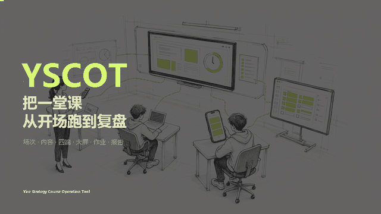
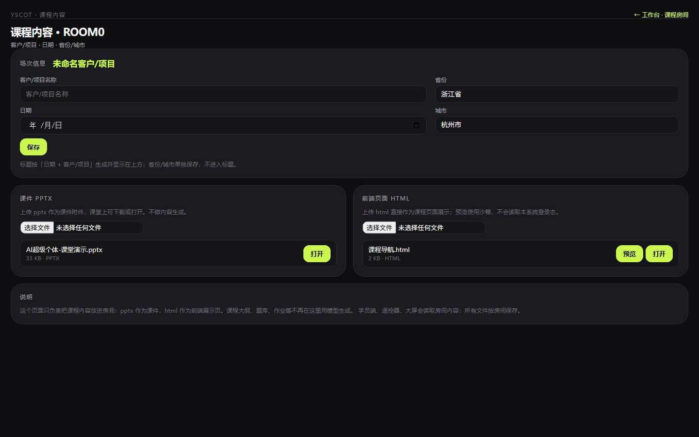
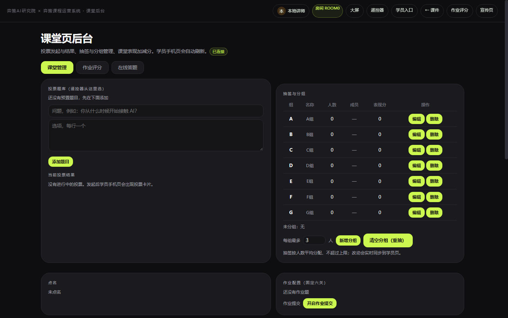
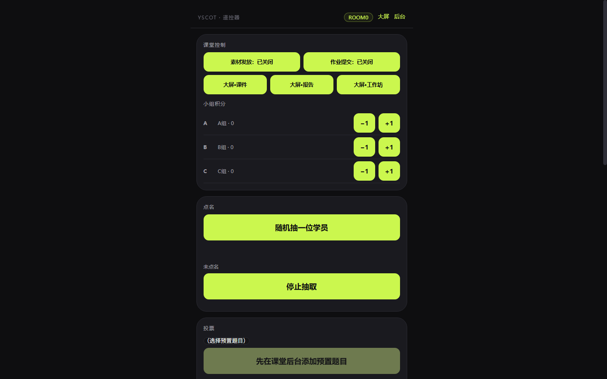
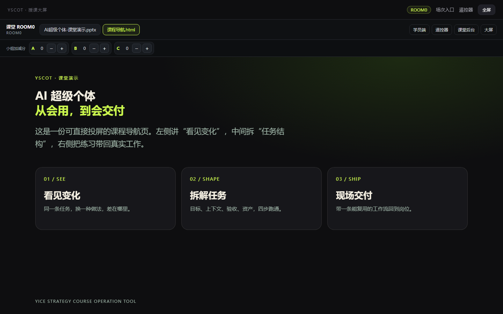
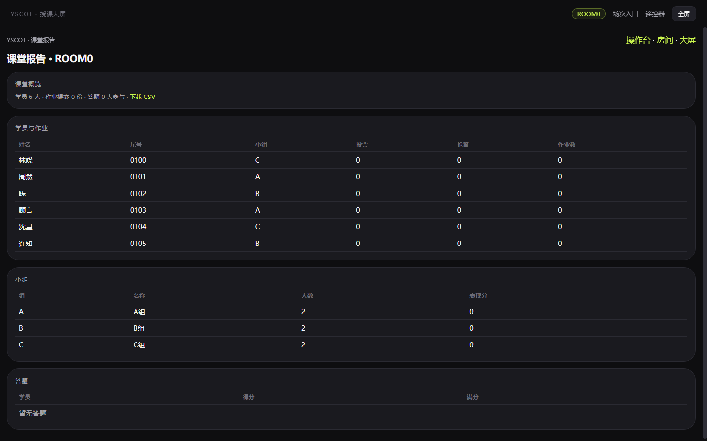
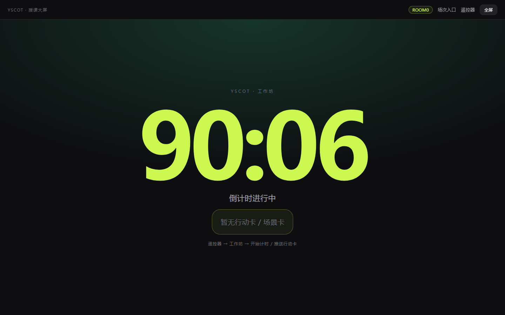
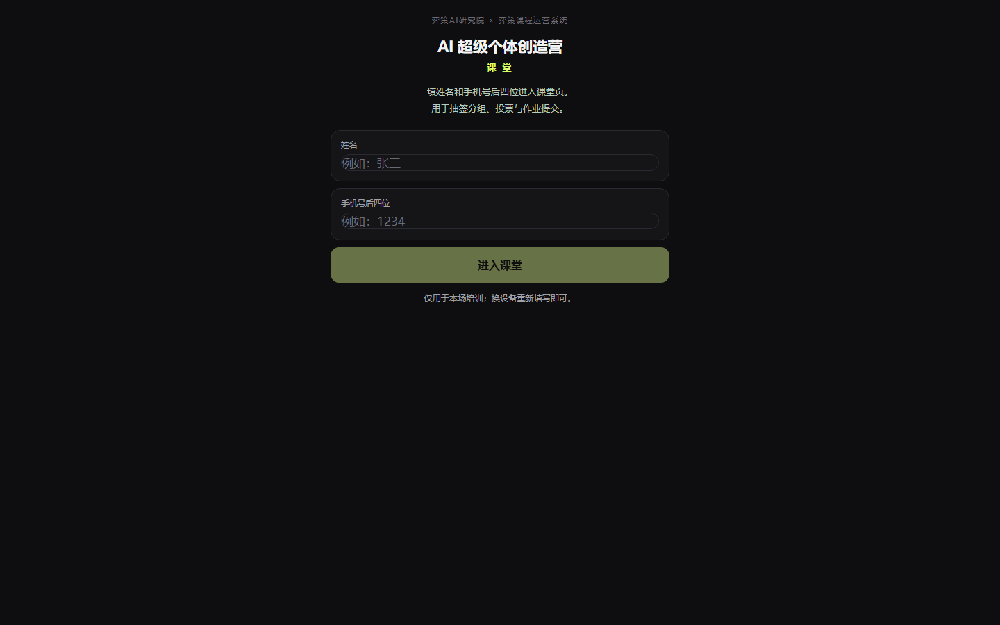
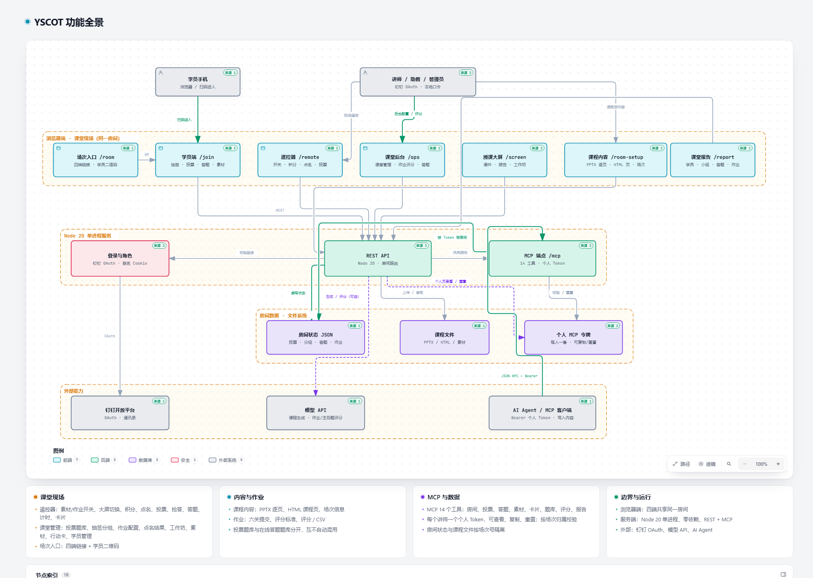

# Yice Strategy Course Operation Tool（弈策课程运营系统）

简称 **YSCOT**。

<strong>把一堂企业 AI 培训，从课前准备跑到课后复盘。</strong>

  
  
  
  
  

YSCOT 是一个面向企业 AI 培训现场的 **课堂运营系统**。它不替代课程设计，而是把课程设计之后最容易散掉的那一段接起来：

- **课前**：建场次、放课件、导入题库 / 素材 / 卡片 / 评分标准；
- **课中**：遥控器、课堂后台、授课大屏、学员手机四端同时跑；
- **课后**：作业评分、课堂报告、数据导出，房间留下完整过程。

> 线上环境：<https://yscot.clawshell.online>  
> Node 20 零依赖服务 · 钉钉登录 · 房间模型 · 可私有化部署

---

## 演示：一节课怎么跑

  

8 秒预览 · 93 秒完整演示　·　点击打开播放页

<a href="docs/images/demo-90.mp4">也可以直接打开 MP4</a>

> GitHub README 会过滤 `<video>` 标签，MP4 不能真正内嵌；完整视频放在播放页，README 用 GIF 做预览。

演示不是截图轮播：鼠标移动、点击、Tab 切换、小组加分、随机点名、PPTX / HTML 翻页、工作坊倒计时、学员抽签、投票答题和 MCP 接入页都是真实交互录屏，再叠加章节卡和说明字幕。
---

## 为什么做这个

企业培训的痛点通常不是“没有课件”，而是**课件之后的整条链路**：

- 课前：课件、题库、素材、分组规则、评分标准散在不同工具里；
- 课中：投票、抢答、计时、分组、作业提交各用一套，讲师要来回切；
- 课后：作业靠人工翻文件，课堂过程留不下来，下一次还要重来。

YSCOT 的判断是：**一堂课应该有一个统一的“房间”对象。** 内容、人、互动、作业、报告都挂在这个房间上，四个端读写同一份课堂状态。

| 阶段 | 讲师在做什么 | 系统留下什么 |
| --- | --- | --- |
| **课前** | 新建场次，上传 PPTX / HTML，导入题库、素材、行动卡和评分标准 | 场次信息、课程文件、课堂状态 JSON |
| **课中** | 用遥控器控制节奏，用后台管理人和互动，用大屏投课件 / 报告 / 工作坊 | 学员、分组、投票、抢答、答题、作业提交 |
| **课后** | 打开作业评分，核对报告，导出 CSV | 评分结果、课堂报告、可归档的房间数据 |

---

## 四端一屏：谁在用什么

这里的“四端”指课堂上同时运行的四个角色页面；**场次入口**和**课程内容**是讲师在开课前使用的两个前置页面。

| 页面 | 入口 | 谁在用 | 核心动作 |
| --- | --- | --- | --- |
| **场次入口** | `/room?code=ROOM0` | 讲师 / 助教 | 集中打开四端链接、展示学员二维码、管理本场文件 |
| **讲师遥控器** | `/remote?room=ROOM0` | 讲师手机 | 素材 / 作业开关、大屏切换、小组积分、点名、投票、抢答、答题、工作坊、卡片 |
| **课堂后台** | `/ops?room=ROOM0` | 讲师 / 助教电脑 | 课堂管理、作业评分、在线答题三个工作区 |
| **授课大屏** | `/screen?room=ROOM0` | 投影 / 大屏 | 数据报告、课件、工作坊倒计时三种视图 |
| **学员手机** | `/join?room=ROOM0` | 学员 | 扫码加入、抽签分组、投票、抢答、答题、领素材 / 卡片、交作业 |
| **课程内容** | `/room-setup?code=ROOM0` | 讲师 / 助教 | 场次信息、PPTX、HTML 课程页面 |

> **为什么课堂后台没有“课程内容”Tab？**  
> 课程内容统一在场次页面的 `/room-setup` 管理；`/ops` 只保留现场会频繁操作的三块：课堂管理、作业评分、在线答题。入口更少，现场更不容易点错。

---

## 课前：把一节课装进房间

### 1. 建一个场次

登录后进入工作台，点「新建场次」，填写客户 / 项目、日期、省份和城市。场次名称默认由「日期 + 客户 / 项目」生成，也可以手动改。

- 每个场次有 4 位房间码，例如 `6YCJ`；
- 房间码会出现在所有端的 URL 里，也用于 MCP 按场次写入；
- 新建后进入**场次入口页**，四端链接和学员二维码都在这一页。

### 2. 放课程内容

场次页面的「课程内容」支持两类文件：

| 类型 | 课堂上怎么用 |
| --- | --- |
| **PPTX** | 大屏「课件」视图里逐页渲染，支持上一页 / 下一页和页码标签 |
| **HTML** | 作为前端课程页直接在 iframe 中打开，适合交互式课程导航、长页面和自定义版式 |

上传后，学员端、遥控器和大屏读取的是同一份房间文件；不需要再维护一套“大屏专用”的副本。

### 3. 导入题库、素材、卡片和评分标准

课堂后台的「课堂管理」可以手动添加投票题库、分组、行动卡 / 场景卡和作业配置。批量内容建议走 **MCP**，按 `room` 写入同一个场次：

| MCP 工具 | 导入什么 | 典型用途 |
| --- | --- | --- |
| `votebank.put` | 投票题库（遥控器用） | 课前把 5–10 道投票题放进遥控器 |
| `material.put` | 课程素材 | 案例、模板、阅读材料，学员端直接下载 |
| `card.put` | 行动卡 / 场景卡 | 工作坊推进时投到大屏、推到学员手机 |
| `rubric.put` | 作业评分标准 | 按 T1–T6 关卡配置评分点 |

### 三步接入

1. **取令牌**：登录后打开「工作台 → 个人信息 → MCP 接入令牌」，复制自己的 token；每个讲师一套，可随时重置。
2. **配客户端**：URL 用 `https://yscot.clawshell.online/mcp`，请求头带 `Authorization: Bearer <个人 token>`。
3. **先验证**：调用 `tools/list`，看到 `tools` 数组再开始写入。

通用 MCP HTTP 客户端配置：

~~~json
{
  "mcpServers": {
    "yscot": {
      "type": "http",
      "url": "https://yscot.clawshell.online/mcp",
      "headers": { "Authorization": "Bearer <个人 token>" }
    }
  }
}
~~~

命令行验证：

~~~bash
curl -s https://yscot.clawshell.online/mcp \
  -X POST \
  -H "Authorization: Bearer $MCP_TOKEN" \
  -H "Content-Type: application/json" \
  -d '{"jsonrpc":"2.0","id":1,"method":"tools/list"}'
~~~

> `/mcp` 不是普通网页，而是 **POST + JSON-RPC 2.0** 端点。浏览器直接打开会看到接入说明；不带 Bearer 会返回 `401 unauthorized`，这不是服务坏了。
>
> 令牌按讲师生成，只对本人场次生效；在个人页「重置」后旧 token 立即失效。
>
> **投票题和在线答题题库是两套数据。** `votebank.put` 只影响遥控器投票；在线答题要先在后台「在线答题」导入题库，或用 MCP 写入答题题库后再 `quiz.publish`。

完整客户端配置、`initialize` / `tools/call` 请求体、四类内容示例和排错表见 [MCP 接入与排错](docs/10-MCP接入与排错.md)；字段级标准见 [MCP 内容导入标准](docs/09-MCP内容导入标准.md)。

---

## 课中：四个端，一条节奏

### 课堂后台：三个工作区

打开 `/ops?room=ROOM0`，只有三个 Tab：

| Tab | 解决什么 | 现场动作 |
| --- | --- | --- |
| **课堂管理** | 人和互动 | 投票题库、抽签与分组、点名、表现分、作业配置、素材 / 卡片 |
| **作业评分** | 作业批改 | 查看提交、按评分标准打分、导出 CSV |
| **在线答题** | 课堂测验 | 下载模板、导入题库、选顺序 / 随机出题、发布 / 结束答题 |

几个关键行为：

- **抽签与分组**：按人数平均分配，不超过每组上限；支持新增、编辑、删除、清空重抽；
- **点名**：遥控器随机抽一位学员，学员端显示被点到的状态；
- **在线答题**：随机模式下每个学员拿到不同试卷，降低互相抄答案；
- **作业评分**：固定六关的评分结构，支持按评分标准评分和提交情况查看。

### 讲师遥控器：手机就是控制台

遥控器的设计目标是**单手完成课堂动作**，所以高频按钮放在第一屏：

- 第一行：`素材发放` / `作业提交`；
- 第二行：`大屏 · 课件` / `大屏 · 报告` / `大屏 · 工作坊`；
- 往下是小组积分、点名、投票、抢答、答题、工作坊计时和卡片推送；
- 点名支持「随机抽一位学员」和「停止抽取」，停止按钮就在抽取按钮下方。

### 授课大屏：三种视图

大屏不是一块“只能放 PPT”的屏幕，而是课堂节奏的公共显示面：

| 视图 | 显示什么 | 什么时候切 |
| --- | --- | --- |
| **课件** | PPTX 逐页 / HTML 课程页 / 文件标签 / 页码 / 小组加减分 | 讲内容、翻课件、做课堂练习 |
| **报告** | 学员、小组、答题、作业汇总 | 中场复盘、下课前总结 |
| **工作坊** | 大号倒计时、当前行动卡 / 场景卡 | 小组讨论、实战工作坊 |

  
   
  课件视图：文件标签 + 翻页 + 小组加减分

  
   
  报告视图：课上到哪一步，一屏看见

  
   
  工作坊视图：倒计时 + 行动卡

大屏课件页本身也是一个独立页面 `/course-screen?room=ROOM0`，可以单独投屏，也可以被 `/screen` 内嵌。它负责：

- 从房间文件里筛出 `.pptx / .ppt / .html / .htm`；
- 文件标签和 PPTX 页码标签；
- 上一页 / 下一页；
- 每个小组的 `−1 / +1`；
- 学员端、遥控器、后台、大屏四个入口链接。

### 学员手机：扫码就能参与

学员不需要注册账号，填「姓名 + 手机号后四位」即可进入：

1. 抽签分组；
2. 投票、抢答、在线答题；
3. 接收讲师推送的行动卡 / 场景卡；
4. 下载课程素材；
5. 提交作业。

---

## 课后：评分、报告、归档

### 作业评分

课堂后台的「作业评分」是一个嵌入的评分工作台，按房间读取学员提交：

- 查看提交列表和六关完成度；
- 按评分标准逐项打分；
- 查看总分、提交状态；
- 导出 CSV 做二次分析。

### 课堂报告

`/report?room=ROOM0` 汇总：

- 学员、尾号、小组、投票、抢答、作业数；
- 小组人数和表现分；
- 答题得分；
- CSV 导出。

大屏的「报告」视图和报告页共用同一份房间数据，所以课堂上看到的数字和课后导出不会对不上。

---

## 内容怎么进入课堂：一张数据流

~~~mermaid
flowchart LR
  A[场次入口 /room] --> B[课程内容 /room-setup]
  B --> C[房间文件: PPTX / HTML]
  D[MCP 内容导入] --> E[房间状态 JSON]
  C --> E
  E --> F[遥控器 /remote]
  E --> G[课堂后台 /ops]
  E --> H[大屏 /screen]
  E --> I[学员手机 /join]
  F --> J[作业评分]
  G --> J
  J --> K[课堂报告 /report]
~~~

这条链路里有三个边界：

1. **文件在房间里**：PPTX / HTML 按房间保存，不跟浏览器本地绑定；
2. **状态在 JSON 里**：学员、分组、投票、答题、作业都写房间状态；
3. **内容是导入的**：MCP 负责批量写入，课堂后台负责现场微调。

---

## 房间与权限

- **管理员**：看到全部房间，包括默认房间 `ROOM0`；可以管理讲师；
- **讲师**：只看到自己的房间；默认房间不在列表里；
- **默认房间**：作为兜底演示房间存在，不可删除，只提供「清空」；
- **学员**：不需要账号，用姓名 + 手机号后四位进入指定房间。

| 能力 | 管理员 | 讲师 | 学员 |
| --- | :---: | :---: | :---: |
| 新建 / 编辑 / 删除自己的房间 | ✓ | ✓ | — |
| 看到默认房间 | ✓ | — | — |
| 管理讲师 | ✓ | — | — |
| 课程内容上传 | ✓ | ✓ | — |
| 课堂后台 / 遥控器 / 大屏 | ✓ | ✓ | — |
| 学员互动 / 作业提交 | — | — | ✓ |

---

## 一分钟跑起来

~~~bash
git clone https://github.com/jorinyang/YSCOT.git
cd YSCOT/templates
node server.mjs
~~~

打开 <http://127.0.0.1:8899>。首次使用可以配置本地口令，或直接接钉钉登录。

| 页面 | 地址 |
| --- | --- |
| 登录 / 工作台 | `/` → `/home` |
| 场次入口 | `/room?code=ROOM0` |
| 课程内容 | `/room-setup?code=ROOM0` |
| 课堂后台 | `/ops?room=ROOM0` |
| 讲师遥控器 | `/remote?room=ROOM0` |
| 授课大屏 | `/screen?room=ROOM0` |
| 课件大屏 | `/course-screen?room=ROOM0` |
| 学员端 | `/join?room=ROOM0` |

### 环境变量

| 变量 | 作用 |
| --- | --- |
| `PORT` | 端口，默认 `8899` |
| `SESSION_SECRET` | 登录 Cookie HMAC 密钥 |
| `LOCAL_TEACHER_PASSWORD` | 本地口令兜底 |
| `DINGTALK_CLIENT_ID` / `DINGTALK_CLIENT_SECRET` / `DINGTALK_CORP_ID` | 钉钉登录与部门同步 |
| `PUBLIC_URL` | 公网地址，用于钉钉回调和分享链接 |
| `REQUIRE_AUTH` | `1` 开启强制登录 |
| `MCP_TOKEN` | 服务端兜底/管理员令牌；日常使用讲师个人页面 token |
| `DEEPSEEK_API_KEY` / `DEEPSEEK_BASE` / `DEEPSEEK_MODEL` | 模型兜底配置；页面配置优先 |

### Docker

~~~bash
docker build -t yscot .
docker run -d -p 8899:8899 \
  -e SESSION_SECRET=change-me \
  -e LOCAL_TEACHER_PASSWORD=change-me \
  yscot
~~~

生产环境使用 Docker + Nginx 反向代理；部署细节见 [公网部署说明](docs/08-公网部署说明.md)。

---

## 架构

**这张图想说明四件事：**

1. **角色与入口**：学员扫码、讲师 / 助教 / 管理员从场次入口进入同一房间；
2. **课堂四端 + 内容 / 报告**：学员端、遥控器、后台、大屏、课程内容和报告，共用同一份房间状态；
3. **Node 单进程是调度中心**：REST API 负责页面、读写和报告，MCP 端点给 AI Agent 用；每个讲师有自己的 MCP token，按场次归属校验；
4. **本地持久化与外部能力**：房间 JSON、课程文件、个人令牌落在房间数据目录；钉钉、模型 API 和 AI Agent 是外部能力。

> 这版用 archify 重新生成，以原架构图的全景结构为底稿，补全了场次入口 /room、课程内容 /room-setup、大屏课件 /course-screen、报告 /report、作业评分、投票/答题分离和讲师个人 MCP token。
>
> 交互版：[打开可缩放架构图](https://yscot.clawshell.online/architecture) · [候选 JSON](docs/diagrams/architecture-v4.json)

### 设计取舍

| 取舍 | 选择 | 代价 |
| --- | --- | --- |
| 数据层 | 每个房间一份 JSON | 零数据库、可直接拷贝归档；多实例并发写需要额外协调 |
| 服务层 | Node 20 单进程、零依赖 | 部署简单、启动快；高并发多场次需要拆分或加锁 |
| 课件 | PPTX 浏览器端渲染，HTML 用 iframe | 不依赖 Office / 转码服务；复杂动画、字体可能降级 |
| 大屏 | 页面轮询 + SSE | 实现简单、断线可恢复；不是强实时协作 |
| 内容导入 | MCP + 后台手填 | Agent 可批量写；MCP 令牌需要妥善保管 |

**当前边界**：适合单场 / 小规模并发的企业培训现场；不建议多个 Node 实例共享同一个房间目录。HTML 课程页在沙箱 iframe 中打开，不读取本系统登录态。

---

## 目录结构

~~~text
YSCOT/
├─ templates/
│  ├─ server.mjs              房间 / 鉴权 / API / SSE / MCP
│  ├─ ui.css                  全站主题（近黑 + 荧光绿 + 大圆角）
│  ├─ login.html              分屏登录
│  ├─ home.html               工作台：场次 / 模型 / 个人信息 / 讲师
│  ├─ room.html               场次入口：四端链接 + 二维码
│  ├─ room-setup.html         课程内容：场次信息 / PPTX / HTML
│  ├─ course/
│  │  ├─ admin.html           课堂后台：三个 Tab
│  │  └─ grader.html          作业评分（iframe 内嵌）
│  ├─ remote.html             讲师遥控器
│  ├─ screen.html             授课大屏：课件 / 报告 / 工作坊
│  ├─ course-screen.html      课件大屏：文件标签 / 页码 / 小组分
│  ├─ live.html               学员端
│  ├─ report.html             课堂报告
│  ├─ dialog.js / dialog.css  统一弹窗
│  └─ assets/
│     └─ pptx-preview.umd.js  PPTX 浏览器端渲染
├─ docs/
│  ├─ images/                 README 配图、截图、演示 GIF / MP4
│  └─ *.md                    方法论 / 使用说明 / 部署 / MCP
├─ deploy/                    Nginx / Compose / 环境变量模板
├─ Dockerfile
└─ scripts/
~~~

---

## 文档

- [系统说明](docs/03-系统说明.md)
- [课程包架构（房间与课程包）](docs/05-架构-房间与课程包.md)
- [课堂使用说明（按课程流程）](docs/06-课堂使用说明-按课程流程.md)
- [钉钉联调与上线清单](docs/07-钉钉联调与上线清单.md)
- [公网部署说明](docs/08-公网部署说明.md)
- [MCP 内容导入标准](docs/09-MCP内容导入标准.md)

---

## Roadmap

- [x] 房间模型与四端协同
- [x] 钉钉登录、头像 / 角色、讲师与房间权限
- [x] 场次入口：四端链接 + 学员二维码
- [x] 课程内容：PPTX / HTML 按房间保存
- [x] 课堂后台：课堂管理 / 作业评分 / 在线答题
- [x] 大屏：课件 / 报告 / 工作坊三种视图
- [x] 课件大屏：文件标签、页码、小组加减分
- [x] 抽签分组、点名、投票、抢答、随机卷、工作坊计时
- [x] MCP 内容导入（投票题库 / 素材 / 卡片 / 评分标准）
- [x] 课堂报告与 CSV 导出
- [ ] PPTX 更大文件的离线缓存与预加载
- [ ] 多实例 / 数据库模式（多场次高并发）
- [ ] 移动端细节继续打磨
- [ ] 英文界面

---

## 版本记录

| 时间 | 内容 |
| --- | --- |
| **2026-10** | 课堂大屏课件 / 报告 / 工作坊；后台收敛为三个 Tab；课程内容统一到场次页；MCP 四类内容导入；默认房间权限与清空逻辑；PPTX / HTML 共存 |
| **v0.4** | 参考 wb 风格全站改版、分屏登录、工作台四标签、房间归属、四端联动 |
| **v0.3** | 房间模型、大屏 / 遥控器、讲师登录、课程包、嵌入与 MCP |
| **v0.2** | 后台四标签、在线答题、模型管理、AI 评分 |
| **v0.1** | 六页面 + 局域网服务 |

更详细的变更见 [Releases](https://github.com/jorinyang/YSCOT/releases)。

---

## Contributing

欢迎 Issue / PR。提交前请确认：

1. `node server.mjs` 可以本地跑通；
2. 改动的页面在桌面与手机宽度都能正常显示；
3. 不提交真实客户名、讲师信息、密钥与生产数据。

## License

[MIT](LICENSE) © jorinyang
